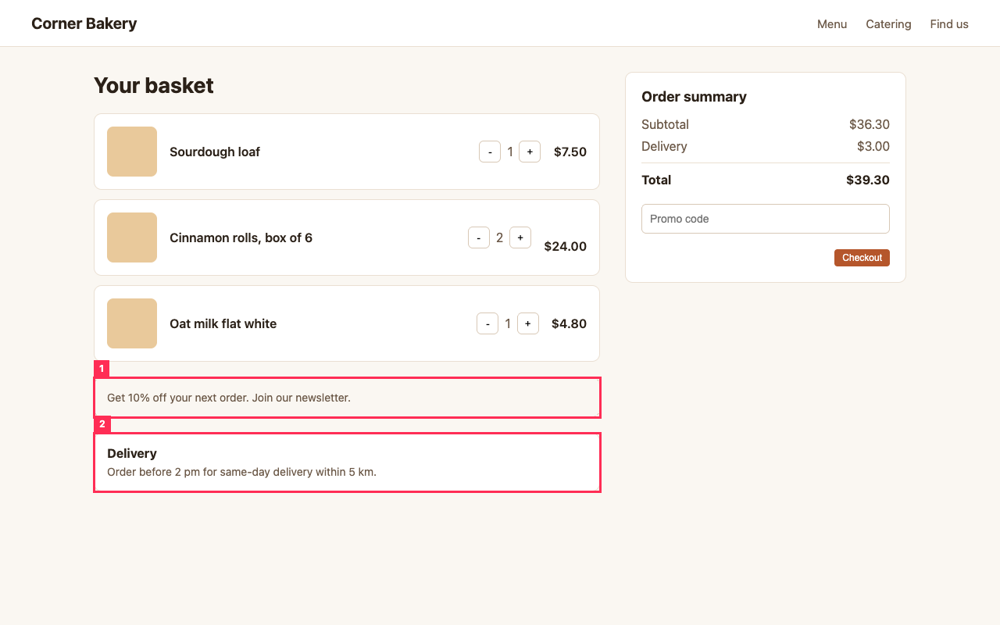

# QA Annotator

Point at what is wrong on a web page, say what is wrong, and hand the result to
a coding agent.

Telling Claude Code (or any coding agent) about a UI bug in words is slow:
"the button in the right column, under the promo field, the small one". QA
Annotator replaces that with a click. You get a folder with one markdown report
and a marked screenshot per issue, plus a prompt on your clipboard that points
the agent at it.

<!-- Replace with a 10-second GIF: press the shortcut, click an element, type a comment, finish. -->


## How it works

1. Press `Cmd+Shift+U` (`Ctrl+Shift+U` on Windows and Linux) on any page.
2. Click the element that is wrong, or drag a box around it, and type what is
   wrong. Repeat for every issue.
3. Press `Cmd+Shift+Enter` to finish. A folder `qa-<date>-<time>` lands in
   `~/Downloads`, and a prompt like this is on your clipboard:

```text
I've been testing manually and found 3 issues I want fixed.

Everything is in /Users/you/Downloads/qa-2026-11-14-1030. Read report.md there, and open the PNG referenced by each issue.
```

Paste it into Claude Code and let it work.

## Example output

[`examples/qa-2026-11-14-1030/`](examples/qa-2026-11-14-1030/) is a real
session on the demo page in [`examples/demo-page/`](examples/demo-page/): a
`report.md` with the page, viewport, CSS selector, element and position of
every issue, and one screenshot per issue with the areas marked.

## Install

It is not on the Chrome Web Store yet. Load it from source:

1. Clone this repository.
2. Open `chrome://extensions` and turn on Developer mode.
3. Click Load unpacked and pick the cloned folder.

No build step and no dependencies. To run the tests: `npm test` (Node 20 or
newer).

## Permissions

| Permission | Why |
| --- | --- |
| `activeTab` | Screenshot the tab you are annotating, only after you press the shortcut or click the icon. |
| `scripting` | Inject the overlay into that tab when you turn QA mode on. |
| `downloads` | Save `report.md` and the screenshots into `~/Downloads`. |
| `storage` | Keep the session in progress if the page reloads or you navigate. |
| Content script on all pages | A tiny keyboard shield that keeps the page's own shortcuts from stealing what you type into the comment box. It does nothing until QA mode is on. |

No network requests, no analytics, no remote code. Everything stays on your
machine.

## Reference

### Shortcuts in detail

`Cmd+Shift+U` (`Ctrl+Shift+U` outside macOS) toggles QA mode on the active tab.
The toolbar icon does the same thing. Escape while QA mode is on turns it off.

While a comment box is open, `Cmd+Enter` saves the issue. `Cmd+Shift+Enter`
finishes the session from anywhere, saving whatever is typed first. Both work
with `Ctrl` outside macOS.

One issue can highlight more than one area, which is what a move needs: the
thing to move and the place it goes. `Cmd+Option+Enter` banks the comment as
one area and hands the picker back, so you can pick the next one. `Cmd+Enter`
finishes the whole issue and takes one screenshot showing every area with its
number. The numbers match the `Area 1` and `Area 2` blocks in the report.

Banked an area you did not mean to? Press `Cmd+Enter` without picking anything
else and the issue is saved with just the areas you already have.

Escape is Cancel. It throws away the whole issue, banked areas included, and
the Cancel button says so. Press Escape again with nothing in progress and QA
mode turns off.

Every area of an issue has to be visible at the same time, because there is one
screenshot. If one has scrolled out of view by the time you save, the tool names
it and saves anyway when you save a second time.

Chrome forbids extension scripts on `chrome://`, `chrome-extension://`,
`about:` and `edge://` pages and on the Web Store, so the shortcut does nothing
there and the service worker console says why.

### What QA mode does to the page

Page events stop at the overlay host. A page handler listening on `document` or
`window` in the bubble phase never sees them. A page handler in the capture
phase still runs, because the event passes it on the way down. That is why the
comment box re-asserts its own focus.

While QA mode is on, the page's own keyboard handlers are suppressed. Native
controls still work, but any JavaScript-driven keyboard widget on the page, a
custom menu or a combobox, is inert until QA mode is off. That is the price of
the comment box keeping its keystrokes.

Scrolling still works, because wheel and scroll are left alone.

Known gap: a tooltip whose content sets `pointer-events: none` cannot be picked
by clicking, because the pick reads what is under the cursor and the browser
reports whatever sits beneath the tooltip. Drag a region over it instead. The
screenshot is identical; the report carries a region rather than a selector.

Known gap: a page's own native modal, opened with `showModal()`, cannot be
annotated while it is open. The overlay is visible on top of it, but the browser
will not let anything outside the modal be clicked or focused. Close the modal
first.

Known gap: a page listener in the capture phase can still observe the
characters typed into the comment box, even though it cannot have them. Do not
type anything secret into an annotation on a page you do not trust.

### After a code change

Two reloads, both needed:

1. The reload icon on the extension card at `chrome://extensions`.
2. A reload of the page under test.

### Privacy

Screenshots of a local app can contain real customer data. They stay on this
machine, unencrypted, in `~/Downloads`. Nothing is transmitted anywhere: no
server, no analytics, no sync. Clear old `qa-*` session folders when you are
done with them.

## License

MIT, see [LICENSE](LICENSE).
